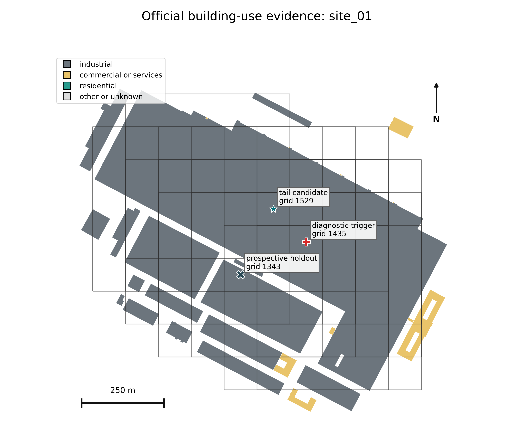
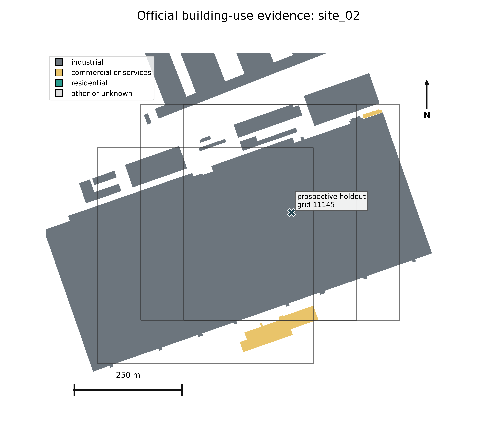
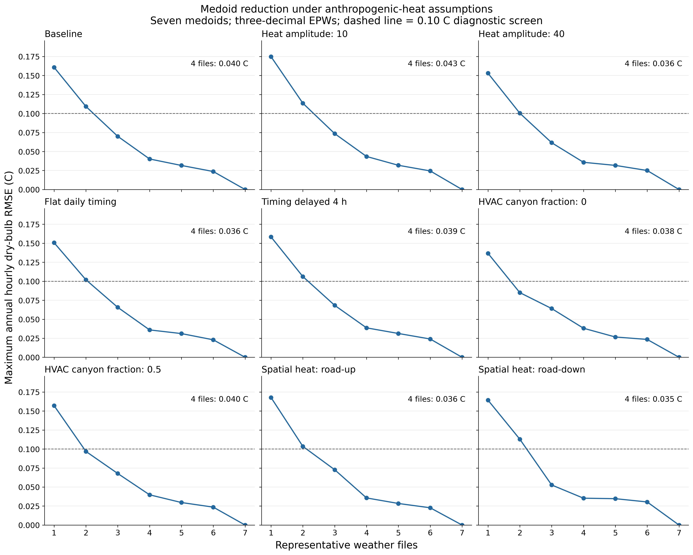
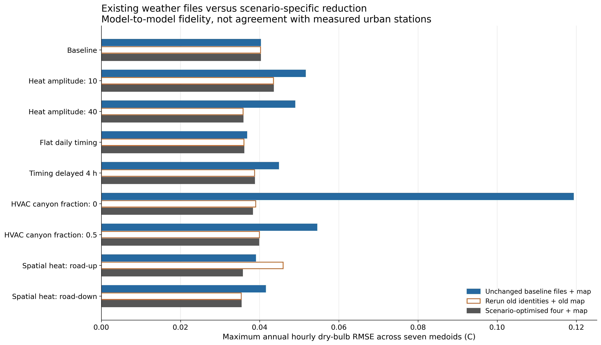
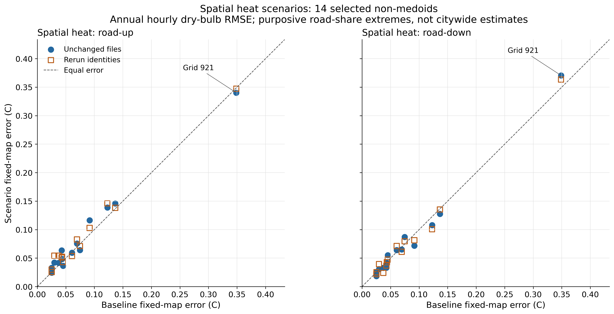
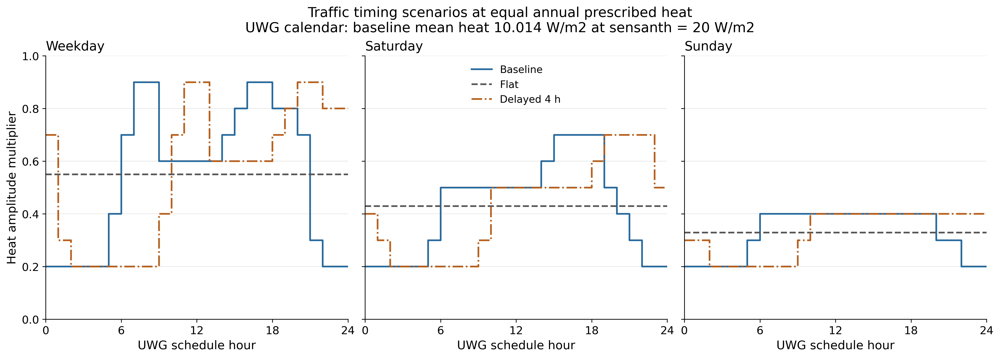

# Supplementary methods and diagnostic results

Supplement to: Morphology-based classification and error-controlled reduction of urban weather files with Torino as a case study

Ali JahaniRahaei and Giacomo Chiesa

Tables S1-S13 are supplied as CSV files in the accompanying archive. Tables S1, S2 and S10-S12 are also reproduced here. Figures S1-S6 are included below and as separate files. File names, units, scenario definitions and execution instructions are listed in README.md.

Supplementary package version 1.0.0: https://github.com/alijahanirahaei/torino-urban-epw-atlas/releases/tag/supplement-v1.0.0

## S1 Spatial inputs and model translation

The municipal boundary, building-volume polygons with heights, road surfaces,
mapped green areas and living-tree inventory supply the spatial inputs. The
measurement-derived weather series have a separate provenance through ARPA
Piemonte and the processed 2014–2023 EPW dataset. The weather dataset is described
by JahaniRahaei, Milelli and Chiesa (2025), DOI
10.1016/j.dib.2025.111708; its dataset DOI is 10.5281/zenodo.14905721.
These identifiers refer to the source weather article and dataset, not the atlas.

Metric operations use Monte Mario / Italy zone 1 (EPSG:3003). Query coordinates
use WGS84 longitude and latitude. The 100 m assignment polygons identify lookup
locations, whereas the morphology is computed over 500 m square supports centred
on those locations. Fractions use the full 250,000 m² denominator even at the
municipal edge, where missing external GIS is flagged. These overlapping supports
are not independent observations or 100 m climate predictions.

Building fraction is unioned footprint area divided by support area. Height is
the footprint-area-weighted mean over valid heights. Exterior facade/site is
global dissolved-footprint exterior perimeter within the square, multiplied by
support mean height and divided by support area. Shared walls and courtyard rings
are excluded; wall-segment heights are not individually integrated. Clipping an
undissolved building and counting its artificial clipped edge would not reproduce
this perimeter definition.

Trees use buffered observed or imputed crown diameters, with crown union to avoid
overlap double counting. Missing crowns follow the archived species, height and
citywide fallback hierarchy. Crown coverage is limited to non-building fraction.
Grass is the nonnegative mapped green remainder after that allocation, capped by
remaining non-building area. It is not a measured map of understorey grass.
Individual tree heights and explicit shadows are not passed to this UWG setup.

An intersection correction retains polygon components within GeometryCollections.
It materially changes canopy at 75 supports but no valid fixed-classifier k = 7 assignment.
Fixed-classifier k = 4 and 8 assignments change at two and three supports. All 19 archived
medoids retain their UWG-relevant inputs. The existing medoids were retained when evaluating the correction. Paired seed tests distinguish the effect of the input correction from variability introduced by approximate optimisation.

## S2 Scale and classification tests

The preliminary building-led cells join building blocks to allocated street and
open context. The production method does not average these cells: it intersects
source geometry directly with regular supports. A citywide irregular-cell audit
identified extreme allocation areas and footprint crossings. These are limits of
that implementation, not proof against every block-based method.

The grid-origin test shifts the 100 m grid by 50 m east and north and
interpolates shifted morphology to 2,401 common coordinates. The matched scale test recalculates 250, 500 and 1000 m squares at 385 matched centres.
The probability component contains 336 draws in 28 strata from the full-1000 m
coverage frame; 304 pass the all-scale quality criteria. Its weighted variance
analysis excludes 13 building-free and 19 inadequately height-covered 250 m
supports. Targeted examples do not enter the probability estimator. These are
different tests and neither measures a unique atmospheric footprint.

The fitting population comprises 10,593 strict-quality supports. Each of five
inputs is centred by its fit median and divided by its interquartile range.
K-means scans k = 2–12; the composite rank is calculated only for k = 4–8.
Weights are 0.25 silhouette, 0.20 Davies–Bouldin, 0.25 spatial perturbation ARI,
and 0.10 each for Calinski–Harabasz, neighbour agreement and elbow curvature.
A two-point penalty applies below 1% minimum class share. The highest-ranked solution is k = 4. The k = 7 solution was selected retrospectively for its morphological distinctions; k = 8 remains an alternative.

Representative supports were selected from six sampled trials of 2,000 supports by minimising the full-population Euclidean distance cost. This CLARA-style procedure is not
an exact global medoid optimum. Within each sample, K-means with ten
initialisations supplies initial groups and their nearest observed centres.
Alternating updates select the within-group point with the smallest summed
pairwise distance, stopping at unchanged medoids or 40 iterations. The algorithm
does not perform a globally optimal PAM swap search. Feature ablations, group balancing and a nonlinear
transform retain this algorithm to isolate representation sensitivity.
Hierarchical Density-Based Spatial Clustering of Applications with Noise
(HDBSCAN) is examined over 12 settings, with both assigned coverage and noise
reported. Its conditional silhouette excludes noise and cannot directly rank a
full-coverage partition. The sampled Ward comparison uses 2,500 supports.
No deep representation or full-city hierarchical experiment was performed.

The buffered spatial test has ten paired repetitions, withholding 20% of occupied
2 km blocks. A 500 m Chebyshev buffer excludes positive support-area overlap
between training and test. Training-only scaling and four trials of 1,500
supports are compared against an equally budgeted full-data reference. ARI is
agreement with that reference, not classification accuracy against independently observed classes. The unbuffered k-means screening scores have a different design. The 0.977 screening score
belongs to k = 2, not k = 7.

## S3 UWG execution and file provenance

The executed model is UWG 5.3.4 (Bueno et al., 2013,
DOI 10.1080/19401493.2012.718797). The accompanying common-template JSON is an inherited scaffold containing
31-day and 1000 m placeholders; it is not the executed annual configuration.
The four representative JSON files and the per-run heat-sensitivity JSONs
record the actual annual support-specific inputs. Executed common assumptions include zone 4A, floor height
3.05 m, characteristic length 500 m, January 1 start, 365 days, a 300 s simulation
step and 3600 s weather interval. Building stock is 40% large office and 60%
midrise apartment, both post-1980 reference types. The sensible anthropogenic heat
amplitude is 20 W m⁻² (10.014 W m⁻² annual scheduled mean), h_mix is 1, and day/night boundary-layer heights are 1000/80 m.
These are shared controls, not district-specific surveyed or calibrated values.
The UWG API spelling is `charlength`, not `char_length`.

AvMY Caselle raw-source SHA-256:
`3430967c3faa30aa3512a34c8fb636003458f162b50c2d2b5ded70707f76a71a`.
The pressure-corrected derivative SHA-256 is
`39c5c8cb90b39fefdfb531ade96700e9436d4df9c8fca3a57191f820d135e5a9`.
Only atmospheric pressure in column 10 (zero-based index 9) is multiplied by
100 from hPa to Pa. Units must be checked before conversion to prevent converting
an already corrected file twice. Original source files are not overwritten.

The production Python wrapper constructs `UWG.from_dict` with the configuration,
effective forcing and output location, then calls `generate()`, `simulate()` and
`write_epw()`. It records failures, durations and input/output hashes. In the
executed version a duplicated final field is removed only after equality checks;
the result must contain eight headers, 8,760 hourly rows and 35 weather columns.
This repair must not be applied to an arbitrary unknown 36-column file.
Standard one-decimal and diagnostic three-decimal serialization are retained
separately. Additional decimal places describe numerical precision, not physical accuracy.

All seven medoids were simulated under the common template to calculate the minimax curve. For each nonempty subset, each parent medoid is represented
by its nearest retained temperature series under hourly RMSE. Enumeration is
exhaustive over 127 subsets. The primary objective minimises the largest class
error; ties are resolved by fitting-support-share-weighted mean error. Shares
are not population or city-area weights. The 7.37 ms timing is the median of 50
search repetitions, excluding I/O and simulation. No larger-set greedy benchmark
was executed.

## S4 Non-medoid coverage and uncertainty scope

The stratified design uses 105 non-medoid supports, 15 per class and three per
distance band (0–25, 25–50, 50–75, 75–95, 95–100 percentiles). Sampling favours
different 1 km blocks and 500 m centre separation; relaxations are recorded.
Class/distance post-stratification weights approximate the represented support
distribution; these are not exact simple-random inclusion probabilities after
spatial selection. An additional 21 purposive cases target boundary margins,
morphological extremes and proposed cleanup switches and receive zero weight in
stratified summaries. Their maximum is a stress diagnostic, not a population
percentile.

All 105 stratified and 20 purposive cases succeed at 300 s. Grid 8230 fails at
that timestep and remains excluded; a 180 s rerun is a separate diagnostic.
The weighted P95 meets the 0.20 °C threshold, and the added P95 relative to seven medoids meets the 0.05 °C threshold. However, grid 1435 exceeds the 0.50 °C stress-test threshold, with an error of 1.331648 °C. The failure already occurs relative to
the original C6 representative and is not generated by merging seven outputs.
Only three of 13 tested boundary/cleanup switches improve annual fidelity.

The high-density C6 analysis defines the tail by building fraction at or above
0.7951808541001185 (the class's 95th percentile) and identifies 20 overlapping
strict-fit supports at two industrial sites. Official geometry/use checks and
the maps below support physical interpretation. A geometry-selected alternative
passes the two prospective holdouts at 0.479013 °C maximum, but the triggering support, grid 1435, remains at 0.559262 °C. Global replacement harms ordinary C6 cases.
The warehouse comparison changes only the building type; it does not calibrate the model against a surveyed building-stock inventory.
No fifth public EPW is adopted. The unqualified four-file recommendation excludes
the flagged tail; this restriction does not resolve the original stress-test failure, and the stratified error distribution was not re-estimated after excluding the tail.

Parameter tests comprise seven common alternatives across all seven medoids,
or 49 annual runs, with eight states including baseline. The four-file scenario criteria require maximum RMSE at most 0.10 °C, a three-to-four improvement at least
twice the four-to-five gain, and fixed-set maximum penalty at most 0.05 °C.
In these seven alternatives, rural/reference parameters, anthropogenic heat
and h_mix stay fixed; the additional heat experiment is described in S7. Crown
uncertainty includes five-fold spatial masking, 23 propagation scenarios and
14 lower/upper-quartile annual medoid runs. The poorly observed no-height subgroup
limits extrapolation. Neither experiment provides a joint uncertainty budget or
a significance test of the benefit of a fifth EPW.

## S5 Synchronized station comparison

The 2022 experiment uses processed, measurement-derived annual files aligned by
nominal calendar and EPW hour in fixed UTC+1. There are 8,760 primary paired
dry-bulb values per station. Uniform source flags do not recover which hours
were measured or imputed. The comparison is therefore synchronized in time, but hourly measurement provenance cannot be resolved from the available processed files.

Bias is model minus urban observation; modelled UHI is model minus Caselle.
RMSE improvement is Caselle-to-station RMSE minus model-to-station RMSE. Positive improvement indicates lower RMSE than the Caselle reference. The primary 95% temporal intervals use 5,000
paired seven-day circular moving-block replicates. One-, three- and fourteen-day
blocks give the same annual improvement direction. A strict flatline sensitivity
removes 62 Reiss Romoli hours and changes annual RMSE by at most 0.03021 °C.
These intervals do not include all measurement or model uncertainty.

2022 seasons are DJF and JJA; main-text Table 9 instead uses October–March
and April–September. EPW labels 07–18 are day and 19–06 are night, not solar
masks. Three urban sites map to weather C and Reiss Romoli to D; A and B have
no urban evaluation station. Alenia's exact 500 m square has only 85.72%
municipal coverage. Among 2022 model outputs, 971 rows with RH above 100% and
960 with dew point above dry bulb were detected across both writer precisions.
Humidity/dew-point/UDI conclusions are excluded for that experiment.

## S6 Reuse and compatibility

The release v0.2.0 GeoPackage contains seven named layers: `grid_assignments`, `cluster_medoids`, `city_boundary`, `morphology_k4`, `morphology_k7`, `morphology_k8` and `weather_categories`. The assignment layer also contains all three k-label columns. Selecting only the default layer does not enumerate the container. For example:

```python
import geopandas as gpd
path = "torino_urban_morphology_epw_atlas.gpkg"
print(gpd.list_layers(path))
grid = gpd.read_file(path, layer="grid_assignments")
medoids = gpd.read_file(path, layer="cluster_medoids")
boundary = gpd.read_file(path, layer="city_boundary")
```

The GIS exports contain classifications and descriptors, not extruded buildings
or a ready-made Dragonfly model. Rhino/Grasshopper supported preliminary spatial exploration;
Python was the executed production route. Grasshopper/Dragonfly import performance was not benchmarked. Reuse must check layer selection,
projected units, a reversible local-origin translation if needed, multipart/holes,
height missingness, shared-wall/courtyard rules and cover denominators. A UWG
parameter JSON is not a Dragonfly geometry JSON.

The atlas and research package are publicly available in GitHub release v0.2.0 at https://github.com/alijahanirahaei/torino-urban-epw-atlas/releases/tag/v0.2.0. The lookup enforces the industrial-tail restriction and withholds downloads at missing-input locations. Supplied features and the fixed classifier support export reconstruction; seven-medoid hourly series support the minimax calculation, and exact configurations and a hash-checked runner support annual UWG execution with the documented source EPW. The research evidence includes HDBSCAN settings, buffered spatial-stability summaries and non-medoid sampling and fidelity tables. Raw-GIS reconstruction, complete clustering refits and reproduction of all station and uncertainty analyses are outside the package's scope.


## S7 Anthropogenic heat and HVAC sensitivity

The additional experiment evaluates whether heat magnitude, timing and spatial
variation change medoid reduction or the use of unchanged weather files. It comprises 84 annual UWG integrations, complementing the common-parameter test without changing
the adopted morphology, baseline configuration or library. Seven medoids are run
under eight alternatives (56 integrations), and 14 non-medoids under two spatial
alternatives (28 integrations). Twenty-one baseline simulations provide matched comparisons. Each scenario integration supplies both one- and three-decimal EPWs.
Three-decimal temperature is the primary diagnostic; additional digits are not
greater physical or observational accuracy.

### S7.1 Parameter definitions and scenario construction

The installed UWG 5.3.4 code supplies non-building sensible heat as the product
of `sensanth` and the weekday, Saturday or Sunday hourly `schtraffic` multiplier.
The baseline configuration includes a diurnal profile. Its nominal
20 W/m2 amplitude produces annual prescribed mean heat of 10.01438356 W/m2;
10 and 40 W/m2 alternatives therefore halve and double that mean. The separate
`h_mix` parameter allocates building HVAC waste heat to the canyon, with the
remainder released from the roof. It is neither boundary-layer depth nor an
additional traffic multiplier. Setting it to zero redistributes HVAC heat; it
does not eliminate building heat generation.

The model advances its clock before applying the traffic schedule and assigns
day types from Julian-day modulo seven rather than the EPW year's civil calendar.
All 105,120 five-minute timesteps were counted, including the final midnight.
The flat and four-hour-delayed profiles were separately normalised by day type
using those exact counts, preserving annual integrated prescribed heat within
floating-point tolerance. All schedule multipliers remain between zero and one.
`heat_sensitivity/schedule_audit.json` retains the counts and resulting profiles.

Spatial heterogeneity is represented by opposing diagnostic orderings, not a
traffic inventory. For each of the 10,593 original fitting supports, q is the
empirical midrank road-fraction percentile: (number below + half the number equal)
divided by 10,593. The road-up amplitude is 10 + 20q W/m2 and road-down is
30 - 20q W/m2. Both have exactly 20 W/m2 mean amplitude over the fitting supports.
This is not an independent city energy budget because the 500 m supports overlap.
Road surface fraction is not traffic volume, speed, vehicle mix or fuel use;
the reverse ordering checks dependence on an unobserved heat-morphology relation.
The bounds are diagnostic perturbations, not calibrated Torino heat estimates.

Explicit traffic-heat modelling is motivated by recent work in a different urban
model and cities (Sun et al., 2026, DOI 10.1029/2025MS005435), but that study does
not validate these Torino proxies or bounds. Its annual-mean flux definition
must not be substituted directly for UWG's schedule-multiplied amplitude.

### S7.2 Non-medoid selection and comparison

Within each class, the minimum and maximum road-share supports were selected
from the 105-support stratified sample (Section S4), with grid-ID tie breaking.
Selection was fixed using GIS attributes before simulation. These 14
supports are purposive contrasts and carry no probability weights in this test.
Both spatial heat patterns were run for each selected support. The industrial-tail restriction remains in force; no new file or class was adopted.

Each scenario retained the original geometry, climate zone 4A, 3.05 m floor height,
500 m characteristic length, office/apartment stock, materials, boundary-layer
and rural/reference parameters. The same pressure-prepared AvMY Caselle source
forced January 1 starts with 365 days, 300 s integration and 3600 s weather steps.
These scenarios are not a synchronized station-calibration experiment.

For each state and writer precision, all 127 nonempty medoid subsets were
evaluated. Selection minimises maximum annual hourly dry-bulb RMSE, followed by
fitting-support-share-weighted mean RMSE and deterministic identifier ordering.
The same criteria as in Section S4 were applied: best-four maximum no greater than 0.10 C;
three-to-four improvement at least twice four-to-five improvement; and at most
0.05 C excess maximum error for the baseline representative identities simulated under each scenario.
These are engineering diagnostics, not statistical confidence bounds or a
global optimisation over the number of weather files.

Comparisons distinguish unchanged baseline C1/C2/C4/C6 files; those identities
rerun under each scenario; fixed versus nearest annual assignments; and the
scenario-specific best four-file subset. Seasonal and clock-bin errors retain
annual assignments. The nine time bins are annual, DJF, JJA, hours 07-18 and
19-06, and the four seasonal day/night combinations. This DJF/JJA convention
applies to this additional AvMY sensitivity experiment, while main-text Table 9 retains its half-year seasons.

Non-medoids were evaluated against their scenario class medoid and the four-file
assignment inherited from their morphology class. Their simulated responses were
not used to select their own best file or to optimise the seven-medoid subset.
Same-support baseline response, Caselle-relative modelled UHI and compression
error have separate reference labels in the machine-readable tables.

### S7.3 Findings and limits

All nine primary states, including baseline, meet the three stated criteria;
best-four maximum annual medoid RMSE is 0.035322-0.043476 C. The largest seasonal
day/night error with the annual best-four mapping is 0.061794 C. The weighted
secondary optimum changes to C1/C3/C5/C6 for zero HVAC canyon allocation, half
allocation and road-up heat. The baseline identity set simulated under each scenario remains equivalent
in the primary minimax objective in every state when nearest assignments may
change. Hence a secondary-optimum change does not require replacing the
representative identities to retain the minimax error, provided their files
are rerun under the scenario.

Unchanged files behave differently from scenario-specific compression. With
`h_mix=0`, the unchanged baseline files and mapping reach maximum annual RMSE
0.119225 C and summer-night RMSE 0.260230 C, while scenario-specific best-four
annual compression is 0.038197 C. C6's summer-night mean falls by 0.2377 C and
its maximum hourly response is 1.114 C. These are model responses, not evidence
of improved observed-station accuracy or a unique cause of nocturnal bias.

The largest annual same-medoid response RMSE is 0.028060/0.047238 C for the
half/double heat amplitudes, and 0.036734/0.038995 C for flat/delayed profiles.
Spatial heat gives maxima near 0.025 C annually, although individual hourly
differences reach approximately 0.42-0.50 C. The selected non-medoid maximum
against its own class medoid is 0.348700 C at baseline and 0.347276/0.363368 C
for road-up/road-down; grid 921 (C6) remains the maximum. Those sample maxima
are not citywide percentiles or bounds for unsimulated supports.

At three-decimal precision, three files meet the 0.10 C tolerance in seven
states and two do in the two HVAC-allocation states. Four is therefore not the
minimum count implied by this tolerance alone. At one decimal, road-down fails
the improvement-ratio criterion (0.975955 rather than at least 2), despite acceptable
four-file RMSE of 0.058637 C. Half-HVAC also changes preferred representatives
between precisions. Thus the curve criterion is not fully serialization-invariant.
Global sensitivity, parameter interactions, observed traffic and local stock or
activity calibration remain outside the tested scope.

### S7.4 Reproducibility and verification

The 84 scenario integrations completed successfully in 960.4 seconds with four
workers, with 3766.659 seconds summed worker time. Separate verification checked
210 EPW serializations (168 new and 42 reused), input hashes and intended changed
keys, timestamp/schema identity, schedule integrals, subset optimisation and
period metrics. The maximum curve discrepancy recalculated with a separate script was
2.78e-17 C. No tested output had relative humidity outside 0-100% or dew point
above dry bulb. Verification was written within the same project, not performed
by an external independent team; it does not establish physical realism.

The accompanying heat-sensitivity folder contains 105 exact per-run JSONs
(84 alternatives and 21 baselines), portable run provenance, expected EPW hashes,
selection and schedule data, full comparisons and a resumable simulation script.
The original 8760-hour AvMY Caselle forcing must be obtained separately from the
companion dataset and verified against its recorded hash. No weather inputs or
generated EPWs are embedded in this lightweight supplement. The runner regenerates these files using the documented source data and local output paths supplied by the user. Its README specifies
the commands, output-precision checks and runtime version. The executable extension reproduces the heat-sensitivity simulations, but not the entire GIS and clustering pipeline. Section S6 describes the repository's other capabilities and limitations.

### Additional reference

Sun, Y., Oleson, K. W., and Zheng, Z. (2026). Modeling Urban Traffic Heat Flux in
the Community Earth System Model: Formulation and Validation for Two Test Sites.
Journal of Advances in Modeling Earth Systems, 18(4), e2025MS005435.
https://doi.org/10.1029/2025MS005435


## Supplementary Table S1

Complete minimax curve under the common UWG configuration. Extra digits distinguish numerical serialization effects; they do not indicate physical accuracy.

| Writer decimals | Files | Representatives | Maximum RMSE (°C) | Weighted mean RMSE (°C) |
|---|---|---|---|---|
| 1 | 1 | k7-C4 | 0.16576927 | 0.08615337 |
| 1 | 2 | k7-C2;k7-C6 | 0.11831677 | 0.07817242 |
| 1 | 3 | k7-C1;k7-C4;k7-C6 | 0.07999715 | 0.03765038 |
| 1 | 4 | k7-C1;k7-C2;k7-C4;k7-C6 | 0.05819782 | 0.03027974 |
| 1 | 5 | k7-C1;k7-C2;k7-C3;k7-C5;k7-C6 | 0.05565098 | 0.01391074 |
| 1 | 6 | k7-C1;k7-C2;k7-C3;k7-C4;k7-C5;k7-C6 | 0.04548069 | 0.00604091 |
| 1 | 7 | k7-C0;k7-C1;k7-C2;k7-C3;k7-C4;k7-C5;k7-C6 | 0.00000000 | 0.00000000 |
| 3 | 1 | k7-C4 | 0.16079733 | 0.07432242 |
| 3 | 2 | k7-C2;k7-C6 | 0.10929367 | 0.06862290 |
| 3 | 3 | k7-C1;k7-C3;k7-C6 | 0.06999050 | 0.02955985 |
| 3 | 4 | k7-C1;k7-C2;k7-C4;k7-C6 | 0.04018696 | 0.01824417 |
| 3 | 5 | k7-C1;k7-C2;k7-C3;k7-C5;k7-C6 | 0.03165222 | 0.00762161 |
| 3 | 6 | k7-C1;k7-C2;k7-C3;k7-C4;k7-C5;k7-C6 | 0.02368211 | 0.00314554 |
| 3 | 7 | k7-C0;k7-C1;k7-C2;k7-C3;k7-C4;k7-C5;k7-C6 | 0.00000000 | 0.00000000 |

## Supplementary Table S2

WGS84 centres of the 100 m assignment cells identifying the four 500 m square representative supports. These are not station coordinates.

| Category | Raw class | Centre grid ID | Longitude (°E) | Latitude (°N) |
|---|---|---|---|---|
| A | C1 | 3788 | 7.72025043 | 45.05026090 |
| B | C2 | 10026 | 7.63526221 | 45.09968571 |
| C | C4 | 5210 | 7.65393902 | 45.06210060 |
| D | C6 | 1524 | 7.62421993 | 45.03024041 |

## Supplementary Table S3

Companion file: `tables/S3_feature_sensitivity.csv`.

The accompanying CSV reports the seven fixed-algorithm feature tests, ARI, aligned assignment agreement and C6 overlap. Agreement measures partition sensitivity, not observed-climate accuracy.

## Supplementary Table S4

Companion file: `tables/S4_parameter_scenarios.csv`.

## Supplementary Table S5

Companion file: `tables/S5_station_2022_intervals.csv`.

## Supplementary Table S6

Companion file: `tables/S6_station_2022_periods.csv`.

## Supplementary Table S7

Companion file: `tables/S7_canopy_imputation.csv`.

## Supplementary Table S8

Companion file: `tables/S8_scale_statistics.csv`.

## Supplementary Table S9

Companion file: `tables/S9_industrial_sites.csv`.

Tables S4–S9 retain the explicit metric, population and scenario columns. S4 reports same-medoid absolute parameter response separately from fixed-set compression. S5 reports paired annual RMSE-improvement intervals. S6 retains DJF/JJA and clock day/night definitions for 2022. S7 lists donor-group support and crown quartiles; these are not guaranteed representations of the missing-height subgroup. S8 separates weighted scale estimands and samples. S9 reports overlapping industrial-site windows, not independent neighbourhoods.

## Supplementary Table S10

Additional scenarios. q is the fitting-population road-share midrank. Exact JSONs and changed keys accompany the table.

| Scenario | Key | Change |
|---|---|---|
| heat_10 | sensanth | 10 W/m2 amplitude |
| heat_40 | sensanth | 40 W/m2 amplitude |
| timing_flat | schtraffic | Flat by day type; equal annual heat |
| timing_late | schtraffic | Four-hour delay; equal annual heat |
| hvac_0 | h_mix | 0 |
| hvac_half | h_mix | 0.5 |
| spatial_road_up | sensanth | 10 + 20q W/m2 |
| spatial_road_down | sensanth | 30 - 20q W/m2 |

## Supplementary Table S11

Primary three-decimal results. Errors are maximum annual medoid RMSE in degrees Celsius. Unchanged files use the fixed baseline assignment. Complete criteria and assignments at both output precisions are in the companion CSV.

| State | Best four | Unchanged files | Minimum at 0.10 C |
|---|---|---|---|
| baseline | 0.040187 | 0.040187 | 3 |
| heat_10 | 0.043476 | 0.051526 | 3 |
| heat_40 | 0.035801 | 0.048878 | 3 |
| timing_flat | 0.036013 | 0.036734 | 3 |
| timing_late | 0.038713 | 0.044770 | 3 |
| hvac_0 | 0.038197 | 0.119225 | 2 |
| hvac_half | 0.039787 | 0.054438 | 2 |
| spatial_road_up | 0.035665 | 0.038950 | 3 |
| spatial_road_down | 0.035322 | 0.041448 | 3 |

At one decimal, road-down fails the improvement-ratio criterion (0.975955; required at least 2), while four-file maximum RMSE is 0.058637 C. Other primary-state criteria are met. Representative changes are secondary tie-breaks, not changes in the primary minimax value.

## Supplementary Table S12

Purposive non-medoid maxima at three decimals. Each maximum is over 14 supports, not a population percentile. Full assignment modes and both precisions are in the companion CSV.

| State | Own-class maximum RMSE (C) | Worst grid |
|---|---|---|
| baseline | 0.348700 | 921 |
| spatial_road_up | 0.347276 | 921 |
| spatial_road_down | 0.363368 | 921 |

## Supplementary Table S13

Companion file: `tables/S13_heat_support_characteristics.csv`. All 21 supports include grid ID, class, road fraction and rank, building density, height, facade/site ratio, tree and grass cover, and baseline shared controls. Heights and lengths are metres; cover and facade/site values are ratios, not percentages. `baseline_json` is relative to `heat_sensitivity/`.

## Supplementary Figure S1



Official mapped building-use evidence for the audited industrial site. Outlined 500 m tail supports overlap; their count is not a count of independent areas. The geometry/land-use audit checks physical plausibility, not observed stock era or temperature accuracy.

## Supplementary Figure S2



Official mapped building-use evidence for the audited industrial site. Outlined 500 m tail supports overlap; their count is not a count of independent areas. The geometry/land-use audit checks physical plausibility, not observed stock era or temperature accuracy.

## Supplementary Figure S3



Complete medoid reduction curves at three-decimal precision for the additional heat scenarios. The dashed line is the 0.10 C diagnostic tolerance, which alone does not require four files. One-decimal results are retained in Table S11 and the full companion CSVs.

## Supplementary Figure S4



Maximum annual error of unchanged baseline files, rerun baseline representatives and scenario-optimised representations against the seven medoids, at three-decimal precision. Both baseline-identity cases use the fixed assignment; the optimised case uses its own mapping. These are model-to-model comparisons, not observational validation.

## Supplementary Figure S5



Annual fixed-map errors for 14 GIS-selected non-medoids, at three-decimal precision. Scenario errors using unchanged or rerun representatives are compared with baseline error. Each support is a purposive road-share contrast; maxima are not citywide error percentiles.

## Supplementary Figure S6



Baseline, flat and four-hour-delayed traffic schedule multipliers by UWG day type. Flat and delayed profiles preserve annual prescribed heat using exact model timestep counts; these are input schedules, not measured traffic or temperature responses. Monthly day/night responses are supplied separately in the companion CSVs.
